# Pontos de atenção e decisões do modelo

| ID | Questão | Decisão atual | Implementação / limite |
|---|---|---|---|
| H01 | Reservar peças na criação? | Conferir disponibilidade; consumir na aprovação. | CreateWorkOrder + ApproveQuote. Duas OS podem inicialmente orçar a mesma peça; a última aprovação sem saldo falha. |
| H02 | Rejeição cancela a OS? | Registrar rejeição e manter AWAITING_APPROVAL. | RejectQuote. Não existe estado de cancelamento. O MVP permite decisão posterior da mesma versão, mas não edição arbitrária do orçamento rejeitado. |
| H03 | Qual versão foi aprovada? | Decisão guarda total e versão; somente uma decisão com a versão atual é aceita. | QuoteVersion + QuoteDecision. `quoteVersion` é obrigatório na API; consulte o orçamento público antes de aprovar ou rejeitar. |
| H04 | Pode executar adicional sem aceite? | Pausar, incrementar versão e exigir nova aprovação. | ProposeAdditionalRepair. Peças consumidas anteriormente não são debitadas outra vez. |
| H05 | Duas aprovações disputam estoque? | Bloquear OS/peças; ordenar locks de peças por ID; gravar tudo ou reverter tudo. | PgUnitOfWork + save de Part com versão otimista. In-memory serializa transações e só publica snapshot após sucesso. |
| H06 | Como notificar o cliente? | Questão aberta. | Não há email, SMS nem entrega de mensagens. Cliente consulta por TrackingCode. |
| H07 | Qual é o tempo médio? | Primeira aprovação até finalização, incluindo espera por adicionais. | WorkOrderQueries.averageExecutionMinutes. Não mede esforço ativo da equipe. |
| H08 | OS pertence a qual unidade? | Questão aberta para evolução multiunidade. | Workshop é cadastro; work_orders ainda não tem workshopId. Não representar associação inexistente. |
| H09 | Todo fato precisa de mensagem/evento persistido? | Registrar envelopes dos fluxos de OS e movimentos de estoque; cadastros continuam persistindo estado. | C01 a C12 estão visíveis na descoberta, mas não geram DomainEvent. Não há infraestrutura de publicação. |
| H10 | Consulta de progresso é um evento? | Não muda o negócio; tratar como query/read model. | TrackWorkOrder. Pode ter observabilidade técnica futura, mas não gera evento de sucesso da OS. |
| H11 | Qual é o limite transacional? | Escrita dos filhos somente pelo repositório da raiz. Aprovação coordena duas raízes no monólito. | WorkOrderRepository.save; PartRepository. Nenhum repositório independente para item/decisão/histórico. |
| H12 | Serviços precisam de máquinas/funcionários? | Fora do escopo atual. | Service representa item precificado do catálogo, sem agenda ou alocação. |
| H13 | Como excluir cliente ou veículo com relacionamentos? | Excluir veículos/OS dependentes e filhos da OS em cascata, preservando histórico de estoque e eventos. | DeleteCustomer e DeleteVehicle delegam a repository.delete(id); FKs CASCADE e SET NULL na migração 0004; equivalente em memória. Catálogo usa desativação. Ver [política de exclusões](exclusoes.md). |

## Estados e decisões

```mermaid
stateDiagram-v2
  [*] --> RECEIVED: receber OS
  RECEIVED --> DIAGNOSIS: iniciar diagnóstico
  DIAGNOSIS --> AWAITING_APPROVAL: apresentar orçamento
  AWAITING_APPROVAL --> AWAITING_APPROVAL: rejeitar / sem consumo
  AWAITING_APPROVAL --> IN_PROGRESS: aprovar versão atual + consumir pendentes
  IN_PROGRESS --> AWAITING_APPROVAL: propor adicional / nova versão
  IN_PROGRESS --> FINISHED: finalizar reparo
  FINISHED --> DELIVERED: registrar entrega
  DELIVERED --> [*]
```

O sistema rejeita o comando quando falta estoque, a versão está obsoleta, o item está inativo ou a transição é inválida. Se a transação falhar, ele não registra a aprovação do orçamento nem a saída da peça.
