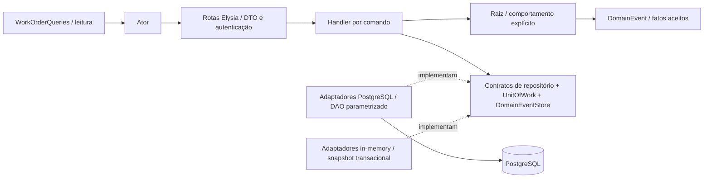

# Modelo tático e responsabilidades

## Agregados e identidade

| Raiz / contexto | Identidade | Entidades internas | Objetos de valor | Repositório |
|---|---|---|---|---|
| Customer / Relacionamento | customer ID | nenhuma | TaxDocument | CustomerRepository |
| Vehicle / Relacionamento | vehicle ID | nenhuma; referencia Customer por ID | VehiclePlate | VehicleRepository |
| Service / Catálogo | service ID | nenhuma | Money | ServiceRepository |
| Part / Estoque | part ID, SKU único | InventoryMovement, histórico persistido pela porta da raiz | Money, StockBalance, Quantity | PartRepository |
| Workshop / Operação | workshop ID | nenhuma | TaxDocument | WorkshopRepository |
| WorkOrder / Atendimento | work order ID; código público alternativo | WorkOrderItem, QuoteDecision, StatusChange | TrackingCode, Quote, QuoteVersion, Money, Quantity | WorkOrderRepository |
| AdminUser / Identidade | user ID | nenhuma | email/hash ainda representados como strings | AdminUserRepository |

Uma raiz também é uma entidade. Uma entidade interna não recebe um repositório independente: isso permitiria alterar o agregado sem validar suas regras. `QuoteDecision` e `StatusChange` recebem identidade na persistência, permanecem imutáveis e pertencem ao histórico da OS. `Quote` é VO porque um orçamento desta versão é descrito por valores; sua versão pertence à OS e não cria outra raiz.

`InventoryMovement` é um registro imutável produzido pelo comportamento da peça e persistido pelo `PartRepository`. O agregado Part não carrega toda sua história ao consultar saldo; a leitura de movimentos é separada, evitando um histórico ilimitado dentro da entidade em memória. Part + movimento + evento são gravados no mesmo UnitOfWork.

## Regras protegidas pelas raízes

### WorkOrder

- Contém ao menos um item na criação, cliente/veículo válidos e reclamação válida.
- Captura descrição, quantidade e preço dos itens. Mudanças de preço do catálogo não recalculam OS existentes.
- Copia e congela suas listas. `WorkOrderItem`, decisões e mudanças são imutáveis.
- `startDiagnosis`: RECEIVED → DIAGNOSIS.
- `submitQuote`: DIAGNOSIS → AWAITING_APPROVAL.
- `approveQuote`: valida versão, registra decisão, marca peças pendentes consumidas e inicia/retoma execução. O handler só persiste se todas as saídas de estoque forem aceitas.
- `rejectQuote`: registra decisão e preserva status/estoque.
- `proposeAdditionalRepair`: só IN_PROGRESS; inclui item, incrementa versão, pausa e apresenta orçamento revisado.
- `finishRepair`: só IN_PROGRESS → FINISHED.
- `recordDelivery`: só FINISHED → DELIVERED.

### Part

- `StockBalance` nunca permite saldo negativo; `Quantity` só aceita inteiros positivos.
- `recordReceipt` e `recordWithdrawal` produzem nova peça, movimento e eventos.
- `consumeForWorkOrder` exige peça ativa e disponibilidade; vincula movimento à OS.
- `MinimumStockReached` ocorre somente quando o saldo cruza de acima do mínimo para menor/igual ao mínimo. Não há envio real de alerta.
- Atualizações usam a versão de Part para recusar gravações concorrentes obsoletas. Movimentos também bloqueiam a linha na transação.

### Demais raízes

Customer controla nome e contato com ações específicas; Vehicle controla marca/modelo/ano e pertencimento por customerId; Service controla preço/duração e ativação; Workshop valida seus dados. A unicidade de CPF/CNPJ, placa e SKU e a integridade referencial são verificadas pelos adaptadores e pelo banco, com comportamento correspondente em memória.

Ainda não foram criados VOs específicos de endereço, email e telefone. São strings no modelo atual; o schema HTTP valida email onde exigido. Eles não são apresentados como VOs implementados nos quadros.

### Exclusões

Excluir cliente ou veículo remove suas OS e os respectivos filhos em cascata. Movimentos de estoque mantêm o registro e perdem o vínculo à OS; eventos já registrados permanecem para auditoria. Serviços e peças usam desativação. A política e os limites transacionais estão em [exclusoes.md](exclusoes.md).

## VOs implementados

| VO | Invariante / igualdade |
|---|---|
| TaxDocument | normalização + CPF/CNPJ válido; igualdade pelo valor normalizado |
| VehiclePlate | placa brasileira válida; igualdade pelo valor normalizado |
| Money | inteiro seguro ≥ 0 em centavos de BRL; soma/multiplicação retornam novos valores |
| Quantity | inteiro seguro > 0 |
| StockBalance | inteiro seguro ≥ 0; entrada/saída retornam novo saldo |
| TrackingCode | 24 bytes aleatórios codificados em base64url; 32 caracteres |
| QuoteVersion | inteiro positivo; `next` cria próxima versão |
| Quote | par total/version; cálculo baseado nos snapshots dos itens |

Todos possuem comparação `equals` e congelamento do próprio objeto. As datas dos históricos são timestamps, não VOs próprios de tempo.

## Comandos e camadas

`ChangeWorkOrderStatus`, `DecideQuote` e `AdjustStock` são adaptadores dos formatos já existentes de API; direcionam para handlers específicos. Eles não contêm transições nem decisões sobre saldo. O domínio não conhece Elysia, Drizzle, SQL, JWT ou Bun.

## Eventos e persistência

A raiz WorkOrder acumula fatos pendentes; o handler salva a raiz e registra esses fatos via `DomainEventStore`. Ao carregar a OS, `pendingEvents` está vazio; salvar novamente um agregado carregado não registra eventos antigos. `Part` retorna fatos com o resultado de sua ação.

`domain_events` é um registro transacional com UUID do evento, nome, tipo/identidade da raiz, data e payload. **Não há Event Sourcing, broker, subscriber, saga, notificação ou projetor assíncrono.** Projeções HTTP consultam o estado persistido diretamente.

A aplicação usa transação envolvendo OS e Part na aprovação. A separação dos agregados continua preservada no modelo, mas sua coordenação é síncrona por uma única aplicação/banco. Se no futuro forem serviços independentes, será necessário decidir reserva, idempotência, integração e compensação; esses mecanismos não estão no MVP.
