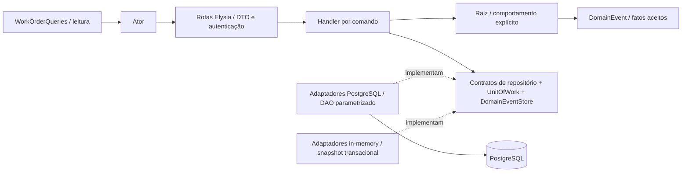

# Modelo tático e responsabilidades

## Agregados e identidade

| Raiz / contexto | Identidade | Entidades internas | Objetos de valor | Repositório |
|---|---|---|---|---|
| Customer / Relacionamento | customer ID | nenhuma | TaxDocument | CustomerRepository |
| Vehicle / Relacionamento | vehicle ID | nenhuma; referencia Customer por ID | VehiclePlate | VehicleRepository |
| Service / Catálogo | service ID | nenhuma | Money | ServiceRepository |
| Part / Estoque | part ID, SKU único | InventoryMovement, histórico persistido pela porta da raiz | Money, StockBalance, Quantity | PartRepository |
| Workshop / Operação | workshop ID | nenhuma | TaxDocument | WorkshopRepository |
| WorkOrder / Atendimento | work order ID; código público alternativo | WorkOrderItem, QuoteDecision, StatusChange | TrackingCode, Quote, QuoteVersion, Money, Quantity | WorkOrderRepository |
| AdminUser / Identidade | user ID | nenhuma | email/hash ainda representados como strings | AdminUserRepository |

Cada raiz também é uma entidade. As entidades internas não têm repositórios próprios, pois isso permitiria alterá-las sem validar as regras do agregado. `QuoteDecision` e `StatusChange` recebem identidade ao serem persistidos. Permanecem imutáveis e fazem parte do histórico da OS. `Quote` é um VO: o orçamento de uma versão é definido pelos valores que contém. A versão pertence à OS e não forma outra raiz.

`Part` produz registros imutáveis `InventoryMovement`, que `PartRepository` persiste. A consulta de saldo não carrega todo o histórico de movimentações; a leitura fica separada para que a entidade em memória não cresça sem limite. A peça, o movimento e o evento são gravados no mesmo `UnitOfWork`.

## Regras protegidas pelas raízes

### WorkOrder

- Contém ao menos um item na criação, cliente/veículo válidos e reclamação válida.
- Captura descrição, quantidade e preço dos itens. Mudanças de preço do catálogo não recalculam OS existentes.
- Copia e congela suas listas. `WorkOrderItem`, decisões e mudanças são imutáveis.
- `startDiagnosis`: RECEIVED → DIAGNOSIS.
- `submitQuote`: DIAGNOSIS → AWAITING_APPROVAL.
- `approveQuote`: valida versão, registra decisão, marca peças pendentes consumidas e inicia/retoma execução. O handler só persiste se todas as saídas de estoque forem aceitas.
- `rejectQuote`: registra decisão e preserva status/estoque.
- `proposeAdditionalRepair`: só IN_PROGRESS; inclui item, incrementa versão, pausa e apresenta orçamento revisado.
- `finishRepair`: só IN_PROGRESS → FINISHED.
- `recordDelivery`: só FINISHED → DELIVERED.

### Part

- `StockBalance` nunca permite saldo negativo; `Quantity` só aceita inteiros positivos.
- `recordReceipt` e `recordWithdrawal` produzem nova peça, movimento e eventos.
- `consumeForWorkOrder` exige peça ativa e disponibilidade; vincula movimento à OS.
- `MinimumStockReached` ocorre somente quando o saldo cruza de acima do mínimo para menor/igual ao mínimo. Não há envio real de alerta.
- Atualizações usam a versão de Part para recusar gravações concorrentes obsoletas. Movimentos também bloqueiam a linha na transação.

### Demais raízes

`Customer` controla nome e contato por ações específicas. `Vehicle` controla marca, modelo, ano e vínculo com `customerId`. `Service` controla preço, duração e ativação. `Workshop` valida seus dados. Os adaptadores e o banco verificam a unicidade de CPF/CNPJ, placa e SKU, além da integridade referencial. O adaptador em memória segue as mesmas regras.

Endereço, email e telefone ainda são strings. O schema HTTP valida o formato do email quando necessário. Os quadros não apresentam esses campos como VOs implementados.

### Exclusões

Ao excluir cliente ou veículo, o sistema também remove suas OS e os filhos dessas ordens. Os movimentos de estoque permanecem, mas perdem o vínculo à OS excluída. Os eventos registrados continuam disponíveis para auditoria. Serviços e peças são desativados. Consulte a [política e os limites transacionais](exclusoes.md).

## VOs implementados

| VO | Invariante / igualdade |
|---|---|
| TaxDocument | normalização + CPF/CNPJ válido; igualdade pelo valor normalizado |
| VehiclePlate | placa brasileira válida; igualdade pelo valor normalizado |
| Money | inteiro seguro ≥ 0 em centavos de BRL; soma/multiplicação retornam novos valores |
| Quantity | inteiro seguro > 0 |
| StockBalance | inteiro seguro ≥ 0; entrada/saída retornam novo saldo |
| TrackingCode | 24 bytes aleatórios codificados em base64url; 32 caracteres |
| QuoteVersion | inteiro positivo; `next` cria próxima versão |
| Quote | par total/version; cálculo baseado nos snapshots dos itens |

Todos possuem comparação `equals` e congelamento do próprio objeto. As datas dos históricos são timestamps, não VOs próprios de tempo.

## Comandos e camadas

`ChangeWorkOrderStatus`, `DecideQuote` e `AdjustStock` adaptam os formatos existentes da API e chamam handlers específicos. Eles não definem transições nem alteram regras de saldo. O domínio não depende de Elysia, Drizzle, SQL, JWT ou Bun.

## Eventos e persistência

`WorkOrder` acumula fatos pendentes. O handler salva a raiz e registra esses fatos por `DomainEventStore`. Ao carregar a OS, `pendingEvents` está vazio; salvá-la novamente não duplica eventos antigos. `Part` retorna os fatos junto com o resultado da ação.

`domain_events` registra, na mesma transação, o UUID e nome do evento, a raiz, a data e o payload. O projeto não usa Event Sourcing, broker, subscriber, saga, notificações ou projetores assíncronos. As rotas HTTP consultam diretamente o estado persistido.

Ao aprovar um orçamento, a aplicação atualiza OS e Part dentro da mesma transação. O modelo mantém os agregados separados, mas uma única aplicação e um único banco coordenam as mudanças de forma síncrona. Se eles virarem serviços independentes, o projeto precisará definir reserva, idempotência, integração e compensação. O MVP não implementa esses mecanismos.
